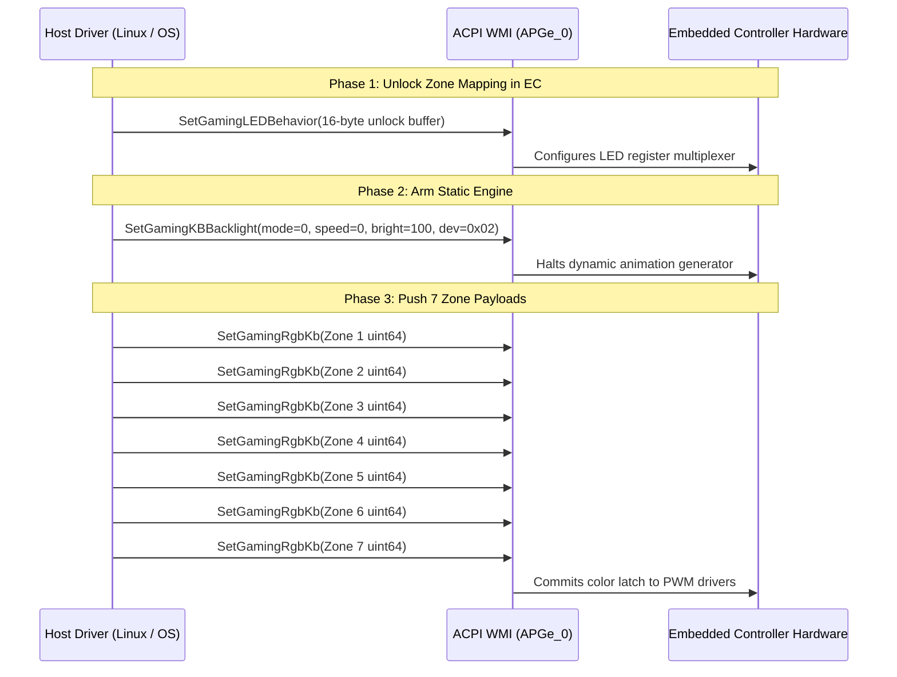

# Acer Predator Rear Lightbar Reverse Engineering Documentation

**Target Laptop Model:** Acer Predator Helios 16 (`PH16-72` / 2024 Series)  
**Author / Research:** Reverse-engineered via Frida dynamic instrumentation, ETW WMI tracing, PE disassembly (Capstone), and ACPI/EC live register analysis.  
**Purpose:** Specification for writing a native Linux kernel driver / userspace daemon (`acer-wmi`, OpenRGB plugin, or standalone driver) to control the 7-zone rear addressable lightbar and hardware animation engine.

---

## 1. Architectural Overview

Unlike the keyboard and lid logo which interface via USB HID (`UsagePage 0xFF02` / `0xFF01`), the rear lightbar is an **Embedded Controller (EC) device mapped directly over ACPI WMI**.

```
   ┌────────────────────────────────────────────────────────────┐
   │             Linux Userspace / OpenRGB / CLI                │
   └─────────────────────────────┬──────────────────────────────┘
                                 │
                                 │ Linux WMI Sysfs / IOCTL
                                 │ or wmi_evaluate_method()
                                 ▼
   ┌────────────────────────────────────────────────────────────┐
   │                   Linux Kernel Driver                      │
   │           wmi-bmof / acer-wmi / custom driver              │
   └─────────────────────────────┬──────────────────────────────┘
                                 │
                                 │ ACPI WMI Evaluation
                                 │ GUID: {7A4DDFE7-5B5D-40B4-8595-4408E0CC7F56}
                                 │ Object: APGe_0  (Device PNP0C14)
                                 ▼
   ┌────────────────────────────────────────────────────────────┐
   │                   ACPI BIOS (DSDT / AML)                   │
   │             Method WMC1 / WMC2 / WMDE / WMTD               │
   └─────────────────────────────┬──────────────────────────────┘
                                 │
                                 │ Port 0x62 / 0x66 Direct I/O
                                 ▼
   ┌────────────────────────────────────────────────────────────┐
   │             Embedded Controller (EC Hardware)              │
   │               ITE / ENE EC RAM Registers                   │
   │        Drives the 7 Addressable ARGB Lightbar Zones        │
   └────────────────────────────────────────────────────────────┘
```

---

## 2. Hardware Identification & ACPI WMI Targets

### 2.1 ACPI Device & WMI GUID
* **ACPI PNP Device:** `PNP0C14`
* **Instance Path:** `ACPI\PNP0C14\APGe_0`
* **WMI Class Name:** `AcerGamingFunction`
* **WMI GUID:** `{7A4DDFE7-5B5D-40B4-8595-4408E0CC7F56}`
* **DriverStore HWID:** `EC\ACPI2` (`AcerECLightbarController`)

### 2.2 Addressable Zones
The rear lightbar physically exposes **7 individually addressable LED zones** arranged horizontally along the laptop's rear heatsink/exhaust trim:
* **Zone 1 (LED Index 0):** Far Left
* **Zone 2 (LED Index 1):** Mid-Left
* **Zone 3 (LED Index 2):** Center-Left
* **Zone 4 (LED Index 3):** Center
* **Zone 5 (LED Index 4):** Center-Right
* **Zone 6 (LED Index 5):** Mid-Right
* **Zone 7 (LED Index 6):** Far Right

---

## 3. Protocol Specification

There are two primary control modes:
1. **Dynamic Animation Effects** (Wave, Breathing, Neon, Snake, Lightning, Motion Point, Zoom)
2. **Individual 7-Zone Static RGB Colors**

---

### 3.1 Dynamic Animation Effects (`SetGamingKBBacklight`)

Dynamic animations are handled entirely by the EC firmware's internal animation engine. Setting an animation requires **a single 16-byte buffer write** to method `SetGamingKBBacklight`.

#### WMI Method: `SetGamingKBBacklight`
* **Input Parameter:** `gmInput: UInt8Array[16]`
* **Output:** `gmOutput: UInt32` (`0x0` = success)

#### 16-Byte Payload Layout:
```
Offset  Type    Name            Description / Valid Values
─────────────────────────────────────────────────────────────────────────────
[0]     uint8   Mode ID         Effect ID (see Mode Table below)
[1]     uint8   Speed           Timer divider: 1 (Fastest) to 5 (Slowest)
[2]     uint8   Brightness      0 to 100 (percentage)
[3]     uint8   Subflag         Always 0x00
[4]     uint8   Target / Flow   0x02 = Rear Lightbar (Default / Flow Left)
                                0x01 = Flow Right
[5]     uint8   Red             Red component (0..255) for single-color effects
[6]     uint8   Green           Green component (0..255)
[7]     uint8   Blue            Blue component (0..255)
[8]     uint8   Config 1        Always 0x03
[9]     uint8   Config 2        Always 0x02
[10..15]uint8[6]Reserved        Padding bytes (always 0x00)
```

#### Mode ID Mapping Table:
| Effect Name | Decimal Mode ID | Hex Byte `[0]` | Supports Custom RGB? | Direction Controllable? |
| :--- | :---: | :---: | :---: | :---: |
| **Static Master** | `1` | `0x01` | **No** (Use 7-Zone handshake for RGB) | No |
| **Wave** | `2` | `0x02` | **No** (Fixed firmware rainbow) | Yes (`0x01`=Right, `0x02`=Left) |
| **Breathing** | `3` | `0x03` | **No** (Fixed firmware color cycle) | No |
| **Neon** | `9` | `0x09` | **No** (Fixed firmware rainbow) | No |
| **Snake** | `10` | `0x0A` | **No** (Fixed firmware rainbow chase) | **No** |
| **Lightning** | `11` | `0x0B` | **No** (Fixed firmware strobe) | No |
| **Stack** | `12` | `0x0C` | **No** (Fixed firmware stack) | No |
| **Motion Point / Zoom** | `13` | `0x0D` | **No** (Fixed firmware dot/zoom) | Yes |

> [!IMPORTANT]
> **Hardware Animation Limitation:**
> In the Helios 16 EC firmware, all hardware animation patterns (`Wave`, `Snake`, `Lightning`, etc.) ignore the RGB parameters in bytes `[5..7]` and run hardcoded rainbow sequences.
> To produce custom-color animations (e.g. single-color breathing or a custom-color snake), the host driver or userspace daemon must implement **software frame-by-frame animation** using the 7-Zone RGB protocol (`SetGamingRgbKb`).

---

### 3.2 Individual 7-Zone RGB Mode (Mandatory 9-Call Handshake)

To set custom static colors across each of the 7 zones independently, the EC hardware **rejects isolated color writes** unless a specific 3-phase hardware handshake is performed.



#### Phase 1: Controller Unlock (`SetGamingLEDBehavior`)
* **Method:** `SetGamingLEDBehavior`
* **Buffer (16 bytes):**
  ```c
  uint8_t unlock_payload[16] = {
      0x10, 0x00, 0x00, 0x00,
      0x00, 0x00, 0xFF, 0xFF,
      0xFF, 0xFF, 0xFF, 0xFF,
      0x55, 0x15, 0x00, 0x00
  };
  ```

#### Phase 2: Static Mode Arm (`SetGamingKBBacklight`)
* **Method:** `SetGamingKBBacklight`
* **Buffer (16 bytes):**
  ```c
  uint8_t arm_payload[16] = {
      0x00, 0x00, 0x64, 0x00,
      0x00, 0x00, 0x00, 0x00,
      0x03, 0x02, 0x00, 0x00,
      0x00, 0x00, 0x00, 0x00
  };
  ```

#### Phase 3: Zone Dispatch (`SetGamingRgbKb`)
* **Method:** `SetGamingRgbKb`
* **Input Parameter:** `gmInput: UInt64` (Little-endian 64-bit integer)

##### 64-Bit Bitfield Structure:
```
  63        48 47    40 39    32 31    24 23    16 15     8 7      0
 ┌────────────┬────────┬────────┬────────┬────────┬────────┬────────┐
 │  Reserved  │  ZONE  │  FLAG  │  BLUE  │ GREEN  │  RED   │  0x00  │
 │   (0x00)   │  MASK  │ (0x08) │ (0-255)│ (0-255)│ (0-255)│ (0x00) │
 └────────────┴────────┴────────┴────────┴────────┴────────┴────────┘
```

##### Bitfield Packing Formula (C / Python):
```c
uint64_t build_zone_val(uint8_t zone_idx, uint8_t r, uint8_t g, uint8_t b) {
    uint8_t zone_mask = (1 << zone_idx); // 0x01, 0x02, 0x04, 0x08, 0x10, 0x20, 0x40
    uint8_t flag = 0x08;                 // Lightbar hardware control flag

    return ((uint64_t)zone_mask << 40) |
           ((uint64_t)flag      << 32) |
           ((uint64_t)b         << 24) |
           ((uint64_t)g         << 16) |
           ((uint64_t)r         << 8);
}
```

##### Zone Bitmasks:
* **Zone 1 (LED 0):** `0x01` (`0x0108BBGGRR00`)
* **Zone 2 (LED 1):** `0x02` (`0x0208BBGGRR00`)
* **Zone 3 (LED 2):** `0x04` (`0x0408BBGGRR00`)
* **Zone 4 (LED 3):** `0x08` (`0x0808BBGGRR00`)
* **Zone 5 (LED 4):** `0x10` (`0x1008BBGGRR00`)
* **Zone 6 (LED 5):** `0x20` (`0x2008BBGGRR00`)
* **Zone 7 (LED 6):** `0x40` (`0x4008BBGGRR00`)

---

## 4. Hardware EC Register Analysis

When WMI methods execute, the ACPI AML code writes directly to physical EC RAM across I/O ports `0x62` (data) and `0x66` (command/status):

| EC Register | Default / Off | Active / Lit | Purpose |
| :---: | :---: | :---: | :--- |
| **`0x83`** | `0x00` | **`0x43`** | **Lightbar Master Power / Enable Gate.** Set to `0x43` whenever lightbar is active; cleared to `0x00` when turned off. |
| **`0x5D`** | `0x26` | `0x36` | Animation / zone latch control status register. |
| **`0x6B`** | `0x3E` | `0x47` | Active lighting effect bank pointer. |

---

## 5. Linux Kernel Implementation Blueprint

### 5.1 ACPI WMI Binding
In Linux, the ACPI WMI subsystem handles evaluation through `<linux/wmi.h>`:

```c
#include <linux/module.h>
#include <linux/acpi.h>
#include <linux/wmi.h>

#define ACER_GAMING_WMI_GUID "7A4DDFE7-5B5D-40B4-8595-4408E0CC7F56"

// Method IDs under the WMI GUID:
// 1 = GetGamingSysInfo
// 2 = SetGamingKBBacklight
// 3 = SetGamingRgbKb
// 4 = SetGamingLEDBehavior
```

### 5.2 Evaluating Methods in Kernel Space

```c
/* Helper to invoke WMI method with a buffer */
static acpi_status acer_wmi_eval_buf(u32 method_id, const u8 *in_buf, size_t len, u32 *out_val) {
    struct acpi_buffer in = { (acpi_size)len, (void *)in_buf };
    struct acpi_buffer out = { ACPI_ALLOCATE_BUFFER, NULL };
    union acpi_object *obj;
    acpi_status status;

    status = wmi_evaluate_method(ACER_GAMING_WMI_GUID, 0, method_id, &in, &out);
    if (ACPI_FAILURE(status))
        return status;

    obj = (union acpi_object *)out.pointer;
    if (obj && obj->type == ACPI_TYPE_INTEGER && out_val)
        *out_val = obj->integer.value;

    kfree(out.pointer);
    return AE_OK;
}

/* Helper to invoke SetGamingRgbKb with a 64-bit value */
static acpi_status acer_wmi_set_rgb_zone(u8 zone_idx, u8 r, u8 g, u8 b) {
    u64 payload = ((u64)(1 << zone_idx) << 40) |
                  ((u64)0x08           << 32) |
                  ((u64)b              << 24) |
                  ((u64)g              << 16) |
                  ((u64)r              << 8);

    struct acpi_buffer in = { sizeof(payload), &payload };
    return wmi_evaluate_method(ACER_GAMING_WMI_GUID, 0, /* SetGamingRgbKb Method ID */ 3, &in, NULL);
}
```

---

## 6. OpenRGB Integration Guide

To implement the rear lightbar in OpenRGB under Linux:

1. **Device Identification:**
   Register the device under `OpenRGBDeviceType::LED_DEVICE_TYPE_NOTEBOOK_STRIP` with name `"Acer Predator Rear Lightbar"`.
2. **Zone Layout:**
   Create a single matrix/linear zone with **7 LEDs**:
   ```cpp
   zone.type = ZONE_TYPE_LINEAR;
   zone.leds_count = 7;
   ```
3. **Commit Function:**
   Whenever `UpdateLEDs()` is called:
   1. Send the 16-byte `SetGamingLEDBehavior` unlock payload.
   2. Send the 16-byte `SetGamingKBBacklight` static arm payload.
   3. Iterate from `0` to `6`, sending `SetGamingRgbKb` for each LED's current `(r, g, b)`.
4. **Transport Layer:**
   * If running as a privileged daemon: talk directly to `/dev/wmi/7A4DDFE7-5B5D-40B4-8595-4408E0CC7F56` or ACPI WMI sysfs interface.
   * If using native port I/O: write the registers to `inb_p`/`outb_p` across ports `0x62`/`0x66`.

---

## 7. Verification & Reference Implementation

A fully working Python reference implementation implementing both win32com and elevated CIM method dispatch is provided in:
[`lightbar_control.py`](file:///c:/Users/veda/Desktop/predatorsense%20reverse%20engineering/lightbar_control.py)
